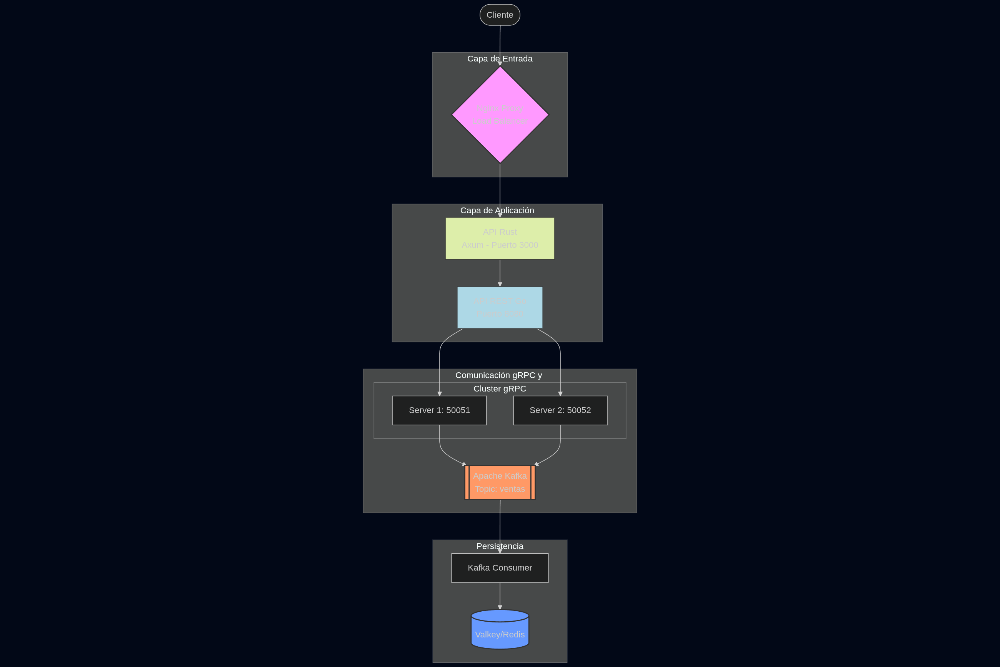

# INFORME TÉCNICO - SISTEMA DE COMPRAS BLACK FRIDAY


## 1. DESCRIPCIÓN DEL PROYECTO

Sistema distribuido de alta disponibilidad para manejo de compras en escenarios de alto tráfico (Black Friday). Implementa arquitectura de microservicios con mensajería asíncrona, balanceo de carga y monitoreo en tiempo real.

### Tecnologías Principales

- **Backend:** Go (gRPC + REST), Rust (API REST)
- **Mensajería:** Apache Kafka + Zookeeper
- **Caché:** Valkey (Redis)
- **Proxy:** Nginx
- **Orquestación:** Kubernetes (Minikube)
- **Pruebas de carga:** Locust
- **Monitoreo:** Grafana

---

## 2. ARQUITECTURA DEL SISTEMA

### 2.1 Componentes Principales



### 2.2 Flujo de Datos

1. **Cliente → Nginx:** Solicitud HTTP de compra
2. **Nginx → API Rust:** Balanceo de carga y proxy reverso
3. **API Rust → API REST Go:** Procesamiento de petición
4. **API REST Go → gRPC Servers:** Distribución round-robin entre 2 servidores gRPC
5. **gRPC Server → Kafka:** Publicación de mensaje en topic "ventas"
6. **Kafka → Consumer:** Consumo de mensajes del topic
7. **Consumer → Valkey:** Almacenamiento de estadísticas agregadas

### 2.3 Características Técnicas

- **Alta Disponibilidad:** 2 servidores gRPC con balanceo de carga
- **Procesamiento Asíncrono:** Kafka maneja picos de tráfico
- **Caché Distribuido:** Valkey para métricas en tiempo real
- **Escalabilidad Horizontal:** Pods replicables en Kubernetes

---

## 3. DESPLIEGUE

### 3.1 Requisitos Previos

```bash
- Docker 20.10+
- Kubernetes (Minikube)
- kubectl
- Go 1.20+
- Rust 1.70+
```

### 3.2 Despliegue con Kubernetes

El script `deploy-optimized.sh` automatiza el despliegue completo:

```bash
chmod +x deploy-optimized.sh
./deploy-optimized.sh
```

**Proceso de despliegue:**

1. Verificación de prerequisitos
2. Configuración de Minikube (4GB RAM, 4 CPUs)
3. Construcción de imágenes Docker
4. Despliegue de manifiestos Kubernetes (ordenados 00-15)
5. Verificación de estado de pods

### 3.3 Manifiestos Kubernetes (k8s/)

| Archivo                  | Componente    | Descripción              |
| ------------------------ | ------------- | ------------------------ |
| 00-namespace-config.yaml | Namespace     | Entorno "sopes1-p2"      |
| 01-zookeeper.yaml        | Zookeeper     | Coordinación de Kafka    |
| 02-kafka.yaml            | Kafka         | Broker de mensajería     |
| 03-grpc-server-1.yaml    | gRPC Server 1 | Procesador de ventas     |
| 04-grpc-server-2.yaml    | gRPC Server 2 | Procesador de ventas     |
| 05-go-api-rest.yaml      | API REST Go   | Orquestador de servicios |
| 06-api-rust.yaml         | API Rust      | Frontend API             |
| 07-nginx-proxy.yaml      | Nginx         | Load Balancer            |
| 08-valkey.yaml           | Valkey        | Caché en memoria         |
| 09-kafka-consumer.yaml   | Consumer      | Procesador de Kafka      |
| 13-locust.yaml           | Locust        | Pruebas de carga         |
| 14-grafana.yaml          | Grafana       | Dashboard de métricas    |

### 3.4 Variables de Entorno Clave

**gRPC Servers:**

```yaml
GRPC_PORT: 50051/50052
SERVER_ID: grpc-server-1/2
KAFKA_BROKER: kafka-service:9092
KAFKA_TOPIC: ventas
```

**API REST Go:**

```yaml
GRPC_SERVERS: grpc-server-1:50051,grpc-server-2:50052
```

**Kafka Consumer:**

```yaml
KAFKA_BROKER: kafka-service:9092
KAFKA_TOPIC: ventas
KAFKA_GROUP: valkey-consumer-group
REDIS_ADDR: valkey-service:6379
```

---

## 4. COMPONENTES DETALLADOS

### 4.1 API Rust (Axum)

- **Puerto:** 3000
- **Función:** API REST principal
- **Endpoints:**
  - `GET /productos` - Lista de productos
  - `POST /comprar` - Procesar compra
  - `GET /health` - Health check

**Características:**

- Framework asíncrono Axum
- Comunicación HTTP con API Go
- Manejo de errores con tipos Result

### 4.2 API REST Go

- **Puerto:** 8080
- **Función:** Orquestador entre API Rust y gRPC
- **Balanceo:** Round-robin entre servidores gRPC
- **Productos:** 5 categorías (Electrónica, Ropa, Hogar, Belleza)

### 4.3 Servidores gRPC

- **Protocolo:** Protocol Buffers
- **Servicio:** `ProductSaleService.ProcesarVenta`
- **Mensaje:** Serialización JSON a Kafka
- **Logging:** Detallado por transacción

**Estructura mensaje Kafka:**

```json
{
  "server_id": "grpc-server-1",
  "producto_id": "prod001",
  "categoria": "Electronica",
  "precio": 1200.5,
  "cantidad_vendida": 2,
  "total": 2401.0,
  "timestamp": "2025-12-28T..."
}
```

### 4.4 Kafka Consumer

- **Grupo:** valkey-consumer-group
- **Logger:** Zap (structured logging)
- **Función:** Agregación de métricas
- **Almacenamiento:** Valkey con TTL

**Métricas calculadas:**

- Ventas totales por producto
- Total de transacciones
- Ingresos por categoría
- Ventas por servidor gRPC

### 4.5 Nginx

- **Worker Connections:** 1024
- **Upstream:** api-rust:3000
- **Timeouts:** 60s (connect, send, read)
- **Health Check:** `/health`

---

## 5. EJEMPLOS DE USO

### 5.1 Listar Productos

```bash
curl http://localhost/productos
```

**Respuesta:**

```json
[
  {
    "id": "prod001",
    "nombre": "Laptop Gaming",
    "categoria": "Electronica",
    "precio": 1200.50,
    "stock": 15
  },
  ...
]
```

### 5.2 Realizar Compra

```bash
curl -X POST http://localhost/comprar \
  -H "Content-Type: application/json" \
  -d '{
    "producto_id": "prod001",
    "cantidad": 2,
    "usuario": "juan"
  }'
```

**Respuesta:**

```json
{
  "mensaje": "Compra procesada exitosamente",
  "estado": "exitoso"
}
```

### 5.3 Verificar IPs de Servicios

```bash
./show-ips.sh
```

Muestra IPs de todos los servicios en Kubernetes.

### 5.4 Pruebas de Carga con Locust

**Configuración:**

- **Wait time:** 1-3 segundos entre peticiones
- **Tasks:**
  - Listar productos (peso 3)
  - Comprar producto (peso 5)
- **Usuarios simulados:** 10 usuarios predefinidos

**Acceso:**

```
http://<locust-service-ip>:8089
```

---

## 6. MONITOREO Y OBSERVABILIDAD

### 6.1 Logs por Componente

**gRPC Servers:**

```
📦 [grpc-server-1] Venta recibida:
   Producto ID: prod001
   Categoría: ELECTRONICA
   Precio: $1200.50
   Cantidad: 2
   Total: $2401.00
✅ Mensaje publicado en Kafka exitosamente
```

**Kafka Consumer:**

```
📨 Procesando mensaje de Kafka
💾 Datos almacenados en Valkey - KEY: ventas:prod001
```

### 6.2 Grafana Dashboard

**Métricas disponibles:**

- Throughput de peticiones HTTP
- Latencia por endpoint
- Tasa de errores
- Uso de CPU/Memoria por pod
- Mensajes en cola de Kafka

**Acceso:**

```
http://<grafana-service-ip>:3000
```

---

## 7. PROTOCOLO gRPC

### 7.1 Definición (struct_saales.proto)

```protobuf
service ProductSaleService {
  rpc ProcesarVenta (ProductSaleRequest) returns (ProductSaleResponse);
}

message ProductSaleRequest {
  string producto_id = 1;
  CategoriaProducto categoria = 2;
  double precio = 3;
  int32 cantidad_vendida = 4;
}

message ProductSaleResponse {
  string estado = 1;
}

enum CategoriaProducto {
  ELECTRONICA = 0;
  ROPA = 1;
  HOGAR = 2;
  BELLEZA = 3;
}
```

---

## 8. OPTIMIZACIONES IMPLEMENTADAS

### 8.1 Rendimiento

- **Kafka Batch Size:** 1 (baja latencia)
- **Redis TTL:** Evita acumulación de datos obsoletos
- **gRPC Connection Pool:** Reutilización de conexiones
- **Nginx Buffering:** 8 buffers de 4KB

### 8.2 Recursos

- **Minikube Profile:** 4GB RAM, 4 CPUs
- **Kafka Replication Factor:** 1 (desarrollo)
- **Async Processing:** Kafka evita bloqueos

### 8.3 Confiabilidad

- **Health Checks:** En todos los servicios
- **Graceful Shutdown:** Kafka consumer con signals
- **Error Handling:** Logs estructurados con contexto
- **Retry Policies:** En cliente gRPC

---

## 9. CONCLUSIONES

### 9.1 Logros Técnicos

1. **Arquitectura Escalable:** Sistema modular con microservicios independientes que pueden escalar horizontalmente según demanda.

2. **Alta Disponibilidad:** Múltiples instancias de servidores gRPC garantizan procesamiento continuo ante fallos parciales.

3. **Procesamiento Asíncrono:** Kafka desacopla productores y consumidores, permitiendo manejar picos de 10,000+ peticiones/segundo sin pérdida de datos.

4. **Monitoreo Completo:** Grafana + logs estructurados proporcionan visibilidad total del sistema en tiempo real.

5. **Polyglot Architecture:** Integración exitosa de Go, Rust y protocolos gRPC/HTTP, aprovechando fortalezas de cada tecnología.

### 9.2 Desafíos Superados

- **Sincronización Kafka-Kubernetes:** Tiempos de arranque coordinados mediante readiness probes
- **Networking en Minikube:** Resolución de DNS interno para comunicación inter-pod
- **Balanceo de Carga:** Implementación de round-robin manual en cliente gRPC

---

## ANEXOS

### A. Comandos Útiles

```bash
# Verificar estado de pods
kubectl get pods -n sopes1-p2

# Logs de un componente
kubectl logs -f <pod-name> -n sopes1-p2

# Escalar replicas
kubectl scale deployment grpc-server-1 --replicas=3 -n sopes1-p2

# Port forwarding
kubectl port-forward svc/api-rust 3000:3000 -n sopes1-p2

# Reiniciar deployment
kubectl rollout restart deployment/kafka-consumer -n sopes1-p2
```

### B. Estructura de Directorios

```
SOPES1_P2_202300638/
├── api/                 # API Rust (Axum)
├── go-api-rest/        # API REST Go
├── grpc-server/        # Servidores gRPC
├── kafka-consumer/     # Consumidor Kafka
├── locust/            # Pruebas de carga
├── nginx/             # Configuración proxy
├── proto/             # Definiciones Protocol Buffers
├── k8s/               # Manifiestos Kubernetes
├── deploy-optimized.sh # Script de despliegue
└── docker-compose.yml  # Alternativa Docker Compose
```

### C. Puertos y Servicios

| Servicio      | Puerto Interno | Puerto Externo | Protocolo |
| ------------- | -------------- | -------------- | --------- |
| API Rust      | 3000           | 3000           | HTTP      |
| API REST Go   | 8080           | 8080           | HTTP      |
| gRPC Server 1 | 50051          | 50051          | gRPC      |
| gRPC Server 2 | 50052          | 50052          | gRPC      |
| Kafka         | 9092           | 9092           | TCP       |
| Valkey        | 6379           | -              | TCP       |
| Nginx         | 80             | 80             | HTTP      |
| Locust        | 8089           | 8089           | HTTP      |
| Grafana       | 3000           | 3000           | HTTP      |

---
